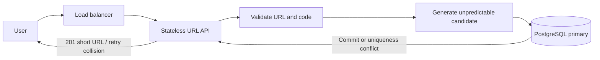
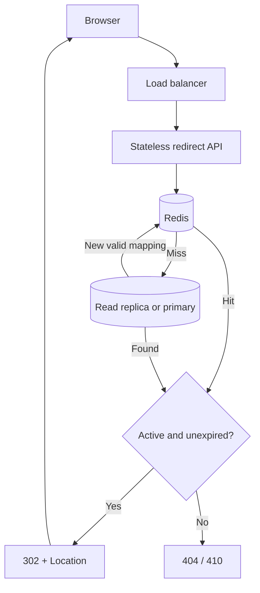
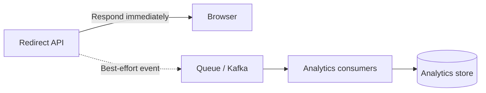

# URL Shortener — System Design (HLD + JavaScript)

> Interview study notes. Design assumptions are illustrative, not measured production requirements.

## 1. Requirements

### Functional
- Convert a long HTTP/HTTPS URL into a short URL.
- Redirect short-code visitors to the original destination.
- Generate hard-to-guess, unique codes; resolve collisions safely.
- Support user-selected custom aliases and optional expiration.
- Optionally support disabling links and click analytics.

### Non-functional
- Prioritize availability of **redirects** over URL creation.
- Aim for p99 service-side redirect latency below 100 ms (excluding the visitor's network).
- Durable mapping storage; strong uniqueness guarantees.
- Newly created mappings should work immediately (read-after-write behavior).
- Scale high read-to-write traffic and viral hot keys.
- Protect against abuse, dangerous URL schemes and unauthorized updates.

## 2. Core workflows

**Write:** validate URL → generate candidate code → atomically insert mapping with unique constraint → return shortened URL.

**Read:** resolve code → check cache → if absent read database → verify active and non-expired → optionally cache → return `302 Found` with `Location` header. Return `404` for unknown codes; consider `410 Gone` for known expired/removed links.

## 3. Capacity estimation

Assume:
- 1,000,000 monthly active users.
- 2 created links per user per month.
- 1,000 monthly redirects per newly created link (simplifying modeling assumption; actual links may be read across months).
- 30-day month and peak = 5× average.

| Metric | Calculation | Result |
|---|---|---:|
| Monthly creations | 1,000,000 × 2 | 2,000,000 |
| Average write QPS | 2,000,000 / 2,592,000 | 0.77 |
| Monthly redirects | 2,000,000 × 1,000 | 2,000,000,000 |
| Average redirect QPS | 2,000,000,000 / 2,592,000 | 772 |
| Peak redirect QPS | 772 × 5 | 3,858 |
| Read/write ratio | 2 billion / 2 million | 1,000:1 |

**Hot-key scenario:** 1 million clicks in one minute on a *single code* ≈ 16,667 redirect requests/sec. Average QPS alone can hide viral peaks.

If each link consumes an illustrative **500 bytes** of logical storage (including rough metadata/index allowance), 2 million links/month ≈ 1 GB/month, ≈ 12 GB/year. Real provisioning must include index overhead, replicas, backups, retention and analytics separately.

## 4. API contract

### Create

```http
POST /api/v1/urls
Content-Type: application/json

{
  "originalUrl": "https://example.com/products/123",
  "customAlias": null,
  "expiresAt": null
}
```

```http
HTTP/1.1 201 Created
Content-Type: application/json

{
  "shortCode": "aB7xK2",
  "shortUrl": "https://sho.rt/aB7xK2",
  "expiresAt": null
}
```

- `400` invalid URL/alias/expiration.
- `409` already-reserved custom alias.
- `429` creation rate limit.

### Redirect

```http
GET /aB7xK2
```

```http
HTTP/1.1 302 Found
Location: https://example.com/products/123
Cache-Control: no-store
```

`302` is a sensible default when link destinations may change or first-party click analytics matter. For immutable permanent destinations, consider `301`/`308` and explicit cache rules. `Cache-Control: no-store` is an illustrative conservative policy, not necessary for every product.

### Disable (authenticated owner)

```http
DELETE /api/v1/urls/aB7xK2
Authorization: Bearer <token>
```

Update authoritative storage and invalidate caches. Exact disable semantics depend on product requirements.

## 5. Data model

```sql
CREATE TABLE short_urls (
  id BIGINT GENERATED ALWAYS AS IDENTITY PRIMARY KEY,
  short_code VARCHAR(16) NOT NULL UNIQUE,
  original_url TEXT NOT NULL,
  user_id BIGINT,
  created_at TIMESTAMPTZ NOT NULL DEFAULT NOW(),
  expires_at TIMESTAMPTZ,
  is_active BOOLEAN NOT NULL DEFAULT TRUE
);
```

The unique index on `short_code` guarantees no two committed records use the same alias. Lookup:

```sql
SELECT original_url, expires_at, is_active
FROM short_urls
WHERE short_code = $1;
```

PostgreSQL is a pragmatic first choice: atomic uniqueness, indexed queries, transactions, backups and replicas. Millions of mappings alone do not necessitate sharding.

## 6. Architecture diagrams

### Write path



### Redirect path



The diagram is conceptual: the **API**, not Redis, drives the database query and cache fill. A read-replica miss for a newly created link may require primary fallback to avoid replication lag.

### Analytics side path (optional)



Analytics must not hold up redirection. Event buffering, dropped-event policy, duplication and backpressure require explicit choices.

## 7. Cache-aside with Redis

- On redirect, check `url:<code>` in Redis first.
- Cache entry should contain destination, active state and expiration metadata.
- On miss, query DB, optionally check primary if a replica misses a just-created code, then populate Redis.
- Cap cache TTL by the mapping's remaining lifetime; never redirect expired links merely because cache contains them.
- On delete/update, invalidate the cache; strict revocation may require extra consistency guarantees.
- Cache stampede: use per-code single-flight, TTL jitter, warm popular links and bounded database fallback.
- Cache failure: fail over to database within protected capacity; do not overload the primary.
- CDN/edge caching is optional and must account for analytics, revocation and TTL semantics.

**Redis vs replicas:** Redis absorbs repeated hot reads; read replicas scale durable DB read throughput. They solve different bottlenecks. Benchmark before adding infrastructure.

## 8. Code generation

### Base62 encoding of numeric IDs

```javascript
const ALPHABET = "0123456789abcdefghijklmnopqrstuvwxyzABCDEFGHIJKLMNOPQRSTUVWXYZ";

function encodeBase62(id) {
  let n = BigInt(id);
  if (n < 0n) throw new Error("ID must be non-negative");
  if (n === 0n) return "0";
  let result = "";
  while (n > 0n) {
    result = ALPHABET[Number(n % 62n)] + result;
    n /= 62n;
  }
  return result;
}

console.log(encodeBase62(1000000n));
```

This is compact and deterministic **but predictable**. It does not satisfy the hard-to-guess requirement by itself.

### Secure random Base62 in Node.js

```javascript
const { randomInt } = require("node:crypto");
const ALPHABET = "0123456789abcdefghijklmnopqrstuvwxyzABCDEFGHIJKLMNOPQRSTUVWXYZ";

function randomCode(length = 8) {
  if (!Number.isInteger(length) || length < 1) throw new Error("Invalid length");
  let code = "";
  for (let i = 0; i < length; i++) {
    code += ALPHABET[randomInt(ALPHABET.length)];
  }
  return code;
}

console.log(randomCode());
```

**Collision handling:** the DB unique constraint is authoritative. On a uniqueness conflict for an auto-generated code, generate another candidate and retry (bounded retry limit). For custom aliases, return `409` instead. Do **not** implement a separate `SELECT` as the only collision prevention; it races under concurrent requests.

Code space: `62^6 ≈ 56.8 billion`, `62^8 ≈ 218 trillion` possibilities. Collisions remain possible even with a large space.

### Small illustrative JavaScript service (pseudocode-level integrations)

```javascript
// db.insertShortUrl, db.findByCode and cache.get/set/del represent
// real PostgreSQL/Redis adapters that you would implement separately.
async function createShortUrl({ originalUrl, customAlias, expiresAt }, db) {
  const parsed = new URL(originalUrl);
  if (!["https:", "http:"].includes(parsed.protocol)) {
    throw new Error("Only HTTP(S) links are supported");
  }
  if (expiresAt && new Date(expiresAt) <= new Date()) {
    throw new Error("Expiration must be in the future");
  }

  for (let attempt = 0; attempt < 5; attempt++) {
    const code = customAlias ?? randomCode(8);
    try {
      await db.insertShortUrl({ code, originalUrl: parsed.href, expiresAt });
      return { shortCode: code, shortUrl: `https://sho.rt/${code}` };
    } catch (err) {
      if (err.code !== "23505") throw err; // PostgreSQL unique violation
      if (customAlias) throw new Error("Alias already taken");
    }
  }
  throw new Error("Unable to allocate unique short code");
}

async function resolveShortUrl(code, db, cache) {
  let item = await cache.get(`url:${code}`);
  if (!item) {
    item = await db.findByCode(code); // consider primary fallback on replica miss
    if (!item) return { status: 404 };
    // Production: cache only with a safe TTL bounded by expiration.
  }
  if (!item.isActive || (item.expiresAt && new Date(item.expiresAt) <= new Date())) {
    return { status: 410 };
  }
  return { status: 302, location: item.originalUrl };
}
```

This code teaches service boundaries; it is **not a complete runnable server** because DB/cache adapters and HTTP routes are intentionally omitted. Custom alias validation, ownership, concurrency behavior, cache write, monitoring and tests need implementing.

## 9. Database replication and consistency

**Replication lag example:** write on primary → immediate read on replica → replica has not replayed write → false `404`.

Mitigations:
- Populate Redis **after** successful database commit.
- Read primary for recent codes or retry primary after replica misses.
- Consider regional replication strategy if serving globally.

For modifications/disable actions, stale cache and CDN responses require invalidation or conservative caching policies.

## 10. Failure scenarios

| Failure | Impact | Response |
|---|---|---|
| Redis unavailable | Extra DB lookups | Bounded DB fallback, circuit breaker |
| Primary unavailable | Cannot create new links | Failover/recovery; redirect from cache/replicas if valid |
| Replica lag | Newly created code may look missing | Primary fallback or cache population |
| API instance dies | Requests may fail | LB health checks, multiple stateless instances |
| Viral hot code | High per-key throughput | Cache/edge capacity, request coalescing |
| Cache eviction | DB bursts | TTL jitter, warm popular codes |
| Analytics queue unavailable | Click analytics delayed or lost | Bounded buffering, separate failure domain |
| Code expires | Must stop redirecting | Validate expiration even on cache hit |

## 11. Kafka: when and why

**Not required for redirect lookup.** Optional for click analytics at scale: produce click events asynchronously, consume by independent workers, aggregate to an analytics store. Kafka adds operational cost and must not block the redirect response. Design for duplicates, event retention/replay, backpressure and consumer retries.

## 12. Security

- Restrict accepted schemes to HTTP/HTTPS and cap URL lengths.
- Validate custom aliases and reserve protected paths.
- Rate limit creation and support abuse/takedown workflows.
- Require ownership/auth for changing or disabling a link.
- Detect malicious destinations and phishing where feasible.
- Be thoughtful about click logs and visitor privacy.

## 13. Interview question bank

### Fundamentals
1. Why is URL shortening read-heavy?
2. Why Base62 vs UUID, and why is sequential Base62 predictable?
3. How do random-code collisions happen and how do you resolve them atomically?
4. Why PostgreSQL vs document DB?
5. Why use `302` rather than `301`?
6. What index does `UNIQUE(short_code)` create?

### Scaling
7. A code gets 1 million requests per minute. Where is the bottleneck?
8. Redis cache or read replicas: what comes first and why?
9. What happens when Redis fails?
10. What is a cache stampede and how do you prevent one?
11. What metrics justify sharding?
12. When does a CDN help or hurt?

### Distributed systems
13. How do you guarantee code uniqueness across servers?
14. What does replication lag do to read-after-write behavior?
15. Two users request the same custom alias simultaneously: who wins?
16. How do cache invalidation and link revocation interact?
17. How does multi-region design change consistency requirements?

### Advanced
18. Where could Kafka fit? Why not on the redirect critical path?
19. How do you handle duplicate click events?
20. How do you support expiration without per-link timers?
21. How would you recover after primary DB loss?
22. How would you test p99 redirect latency?
23. How would you prevent enumeration and phishing abuse?

## 14. Implementation roadmap

1. Node.js + Express service with `POST /api/v1/urls`, `GET /:code`.
2. Validate URLs, implement secure Base62 generation.
3. PostgreSQL schema with unique constraint; retry collisions safely.
4. Implement redirects, custom aliases, expiry and errors.
5. Add unit and integration tests, including concurrent alias claims.
6. Add Redis cache-aside and invalidation.
7. Add rate limiting, monitoring and load tests.
8. Add asynchronous click events only if needed.

## 15. Final design decisions

| Concern | Initial approach |
|---|---|
| Backend | Stateless Node.js service |
| Data store | PostgreSQL primary |
| Short codes | Secure random Base62, DB-enforced uniqueness |
| Redirect | `302 Found` with controlled cache policy |
| Cache | Redis cache-aside if read pressure warrants |
| Additional read capacity | Replicas when database bottleneck justifies them |
| Analytics | Optional asynchronous queue/Kafka |
| Read-after-write | Redis fill after commit or primary fallback |
| Reliability priority | Preserve existing redirects |

**Interview principle:** Start with the simplest correct solution, estimate traffic, identify bottlenecks and justify each additional component with a concrete need.
